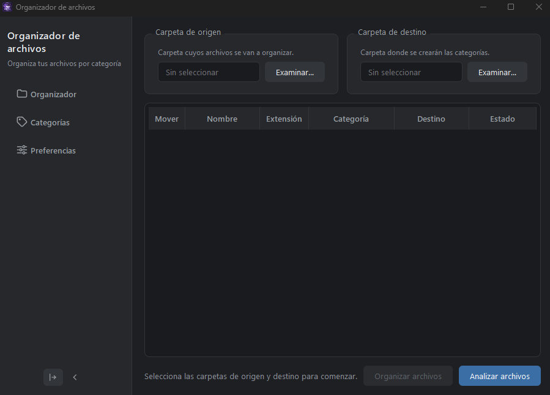
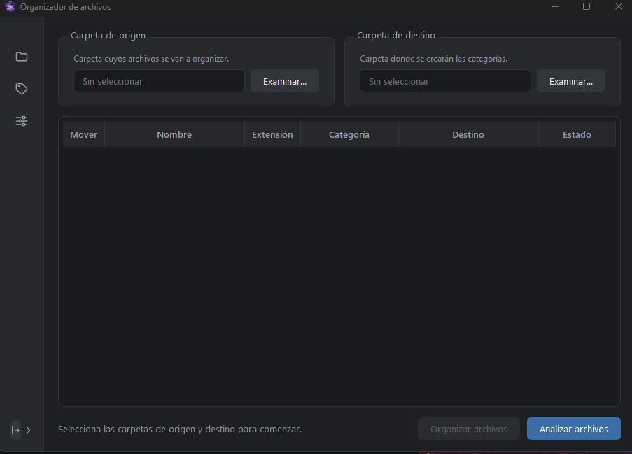
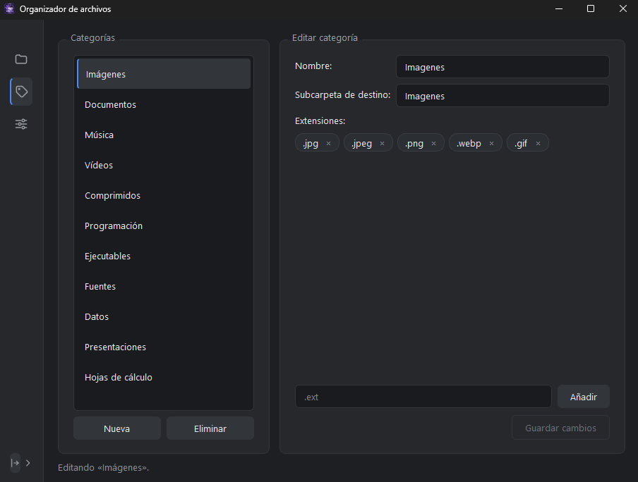
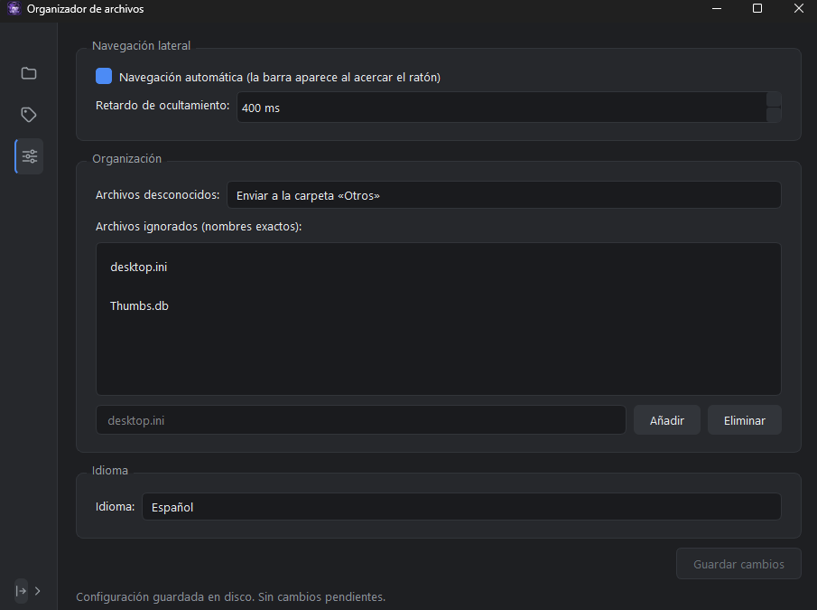
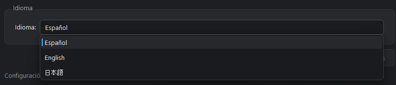

# Organizador de Archivos

Aplicación de escritorio desarrollada con **Python** y **PySide6**,
distribuida como **ejecutable portátil para Windows**, que ordena archivos
en carpetas por categoría (imágenes, documentos, música, vídeos…), con
vista previa del plan completo **antes** de mover nada.

Es la evolución con interfaz gráfica de un script de consola anterior
(carpeta `Organizador/`), conservado en este repositorio como primera
versión del proyecto.

> 📦 **Descarga para Windows:** el ejecutable portátil
> (`Organizador-de-Archivos-v1.0-Windows.zip`) está disponible en la
> sección [**Releases**](../../releases/latest) de este repositorio.
> El ZIP incluye su checksum SHA-256 para verificar la descarga.

*Este es un proyecto personal de práctica y portafolio de programación:
no es un producto comercial.*

---

## Funcionalidades

- Organiza archivos por extensión en carpetas de categorías.
- Reconoce extensiones en mayúsculas y minúsculas.
- Crea las carpetas de destino cuando son necesarias.
- Evita sobrescribir archivos con nombres duplicados.
- Vista previa del plan: cada archivo con su categoría, destino y estado
  (listo, conflicto, ignorado…), con casillas para excluir archivos
  concretos.
- Barra de progreso y resumen final (movidos, omitidos, fallidos).
- Ejecución del movimiento en un hilo secundario: la interfaz nunca se
  congela.
- Editor de categorías: nombre, subcarpeta de destino y extensiones,
  con validación (duplicados, extensiones de otra categoría, nombre
  reservado).
- Comportamiento configurable para archivos desconocidos (enviar a
  `Otros`, ignorar o marcar como advertencia) y lista de archivos
  ignorados por nombre exacto.
- Interfaz en **español, inglés y japonés**, cambiable en caliente sin
  reiniciar.
- Preferencias e idioma persistidos entre sesiones.

## Capturas de pantalla

Ventana principal, con la barra lateral contraíble y la vista previa del plan:



Navegación entre páginas (Organizador · Categorías · Preferencias):



Editor de categorías, extensiones y subcarpetas de destino:



Preferencias de comportamiento (archivos desconocidos, ignorados, destino):



Interfaz disponible en español, inglés y japonés, cambiable en caliente:



## Tecnologías

| Componente | Tecnología |
|---|---|
| Interfaz gráfica | Python 3.10+ · PySide6 6.12 (Qt Widgets) |
| Motor de organización | Biblioteca estándar (`pathlib`, `json`) |
| Pruebas | `unittest` (140 pruebas) |
| Distribución Windows | PyInstaller 6.22 (onedir, windowed) |
| Internacionalización | Diccionarios centralizados propios con paridad verificada por pruebas |

## Arquitectura y estructura del proyecto

```
.
├── docs/capturas/          Capturas de pantalla del README
├── Organizador/            Script original de consola (v1.1)
├── App/                    Aplicación de escritorio
│   ├── main.py             Punto de entrada
│   ├── gui/                Interfaz PySide6
│   │   ├── main_window.py  Shell con barra lateral contraíble
│   │   ├── paginas/        Organizador · Categorías · Preferencias
│   │   ├── i18n/           Catálogos de textos (ES/EN/JA)
│   │   ├── hilos/          Ejecución del plan en QThread
│   │   ├── recursos/       Iconos SVG + icono de la aplicación
│   │   ├── theme.py        Tema oscuro grafito (QSS)
│   │   └── rutas.py        Ubicación de config.json (dev / %APPDATA%)
│   ├── organizador/        Motor independiente de la interfaz:
│   │                       models · config · core · excepciones
│   ├── tests/              Pruebas (unittest, 140 casos)
│   ├── requirements.txt    PySide6-Essentials
│   ├── OrganizadorArchivos.spec   Spec de PyInstaller
│   └── EMPAQUETADO.md      Guía de empaquetado
└── Distribucion/           ZIP Windows + SHA256SUMS + README de usuario
```

El motor (`organizador/`) no depende de la interfaz: la GUI calcula un
*plan* con `core.planificar()`, lo muestra en tabla y lo ejecuta con
`core.ejecutar_plan()` desde un `QThread`.

En desarrollo la configuración vive en `App/config.json`; en la
aplicación empaquetada se guarda en
`%APPDATA%\OrganizadorArchivos\config.json` (con migración automática
de configuraciones antiguas, siempre copiando y sin borrar el original).

## Ejecutar desde el código fuente

### Requisitos

- Windows 10/11 (64 bits).
- Python 3.10 o superior.

### Configurar el entorno virtual e instalar dependencias

Desde la carpeta `App` del repositorio (PowerShell):

```powershell
python -m venv .venv
.venv\Scripts\activate
pip install -r requirements.txt
```

### Ejecutar la aplicación

```powershell
.venv\Scripts\python.exe main.py
```

### Ejecutar las pruebas

```powershell
.venv\Scripts\python.exe -m unittest discover -s tests
```

Las pruebas usan configuraciones temporales y nunca escriben en
`App/config.json`.

## Distribución Windows

- Empaquetado con PyInstaller en modo **onedir** y **windowed**
  (sin consola): la carpeta del ZIP contiene `OrganizadorArchivos.exe`
  y su subcarpeta `_internal`, que debe conservarse junto al ejecutable.
- El ZIP, su `SHA256SUMS.txt` y el README de usuario final se generan
  en la carpeta `Distribucion/` (ver `App/EMPAQUETADO.md` para
  reproducir el empaquetado).
- La aplicación no lleva firma digital ni instalador: al primer arranque
  Windows SmartScreen puede pedir confirmar manualmente.

## Idiomas

Interfaz disponible en **Español**, **English** y **日本語 (japonés)**.
El idioma se cambia desde *Preferencias* y queda guardado.

## Licencia

Este proyecto se distribuye bajo la [Licencia MIT](LICENSE).
